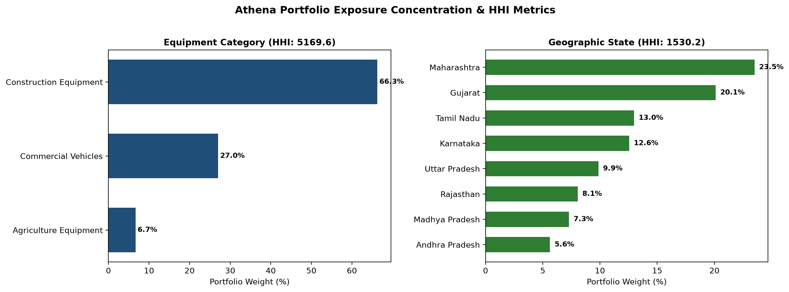
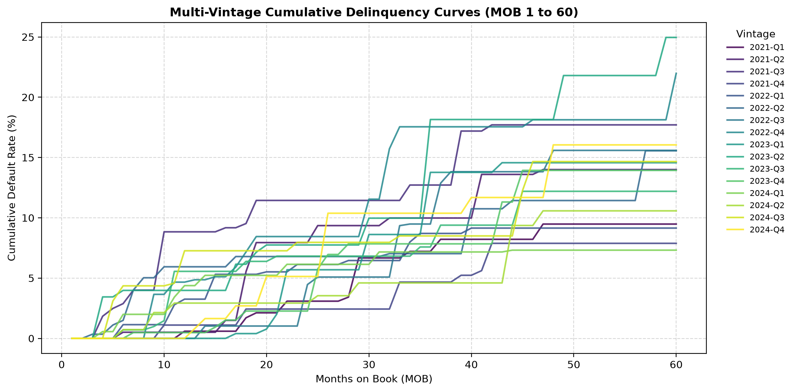
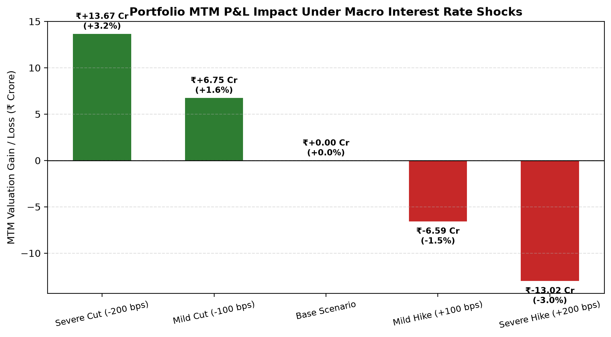

# Lease_Intel: Equipment Lease Portfolio Intelligence & Quantitative Risk

Lease_Intel is an end-to-end quantitative financial engineering pipeline built to analyze, value, and stress-test commercial equipment lease portfolios. Orchestrated using Dagster and a 3-tier Medallion architecture (Bronze, Silver, Gold), it integrates contract-level tapes with Reserve Bank of India (RBI) macroeconomic series. The system provides institutional-grade accounting valuation, credit risk monitoring, and macro interest rate sensitivity modeling across multi-billion-rupee lease books.

---

### Technologies Used & Python Packages

* **Python:** Core language for pipeline logic and quantitative data modeling.
* **Dagster & Dagster Dev:** Data asset orchestration, dependency graph execution, and local development UI server (`dagster dev`).
* **Pandas:** Tabular financial data manipulation, schema transformation, and aggregation.
* **Matplotlib:** Statistical plotting and chart generation for risk figures.
* **LibreOffice Calc & Writer:** Spreadsheet verification of contract/cashflow dataa and document review of generated reports.

---

### What Solution It Provides
* **Automated Lease Accounting (ASC 842 / IFRS 16):** Decomposes contract cash flows into Gross Investment (GIL), Net Investment in Leases (NIL), and Unearned Finance Income (UFI).
* **Multi-Dimensional Concentration Risk:** Evaluates portfolio diversification against regulatory Herfindahl-Hirschman Index (HHI) thresholds across equipment classes, credit tiers, and states.
* **Credit Seasoning & Static Pool Analytics:** Builds 60-quarter vintage delinquency curves (MOB 1 to 60) with enforced mathematical monotonicity for IFRS 9 / Ind AS 109 Expected Credit Loss (ECL) modeling.
* **Macro Stress Testing & ALM Sensitivity:** Revalues future portfolio cash flows across ±200 bps parallel interest rate shocks, measuring effective duration, convexity, and mark-to-market P&L impact.

---

### 1. Problem-Solving Approach & Workflow

Equipment lease portfolios carry structural risks: capital concentration in heavy machinery, borrower credit default risk, and interest rate mismatches between fixed-rate lease receipts and floating funding costs. LeaseIntel addresses these challenges through a modular, reproducible Medallion Architecture:

```
[Raw Data Sources]
  ├── synthetic_leases/ (contracts.csv, monthly_cashflows.csv)
  └── rbi_macro/        (policy repo rates, call money, 91-day t-bills, NBFC credit)
          │
          ▼
[Bronze Layer] Strict schema ingestion, date alignment, and raw data validation
          │
          ▼
[Silver Layer] ASC 842 / IFRS 16 valuation schedules, macro benchmark spread joins, CIBIL tiers
          │
          ▼
[Gold Layer]   HHI concentration indices, 60-quarter vintage curves, ±200 bps yield curve shocks
```

* **Bronze Layer:** Ingests 4,500 lease contracts and 190,356 cash flow records alongside historical RBI macroeconomic benchmarks without altering raw source data.
* **Silver Layer:** Computes contractual amortization schedules, unearned income, contractual-to-macro spreads, and credit score bucketing.
* **Gold Layer:** Generates executive-ready risk matrices, capital adequacy metrics, and publication-quality visual figures.

---

### 2. Portfolio Valuation & Accounting Baseline (Bronze & Silver)

The baseline portfolio covers **4,500 active lease agreements** originated between **January 2010 and December 2024**, with scheduled monthly cash flows extending through **December 2029**.

#### Core Accounting Aggregates (ASC 842 / IFRS 16)
| Accounting Metric | Value (INR) | Portfolio Significance |
| :--- | :--- | :--- |
| **Total Financed Principal (NIL at Inception)** | **₹2,385.07 Crore** | Net capital deployed across all 4,500 leases |
| **Gross Investment in Leases (GIL)** | **₹3,124.13 Crore** | Total undiscounted contractual payments receivable |
| **Total Unearned Finance Income (UFI)** | **₹739.06 Crore** | Embedded future interest earnings (GIL minus NIL) |
| **Portfolio Weighted Average Rate** | **11.95% p.a.** | Contractual implicit interest rate across portfolio |
| **UFI-to-Gross Investment Ratio** | **23.66%** | Structural interest yield buffer across asset tenors |

#### Equipment Category & Credit Risk Breakdown
* **Construction Equipment:** ₹1,580.99 Cr financed (66.3% of volume, 1,337 contracts, avg tenor 48.2 mo, avg rate 12.71%). High unit costs and longer tenors command higher interest margins to offset asset cyclicality.
* **Commercial Vehicles:** ₹644.89 Cr financed (27.0% of volume, 2,042 contracts, avg tenor 41.9 mo, avg rate 11.98%).
* **Agriculture Equipment:** ₹159.19 Cr financed (6.7% of volume, 1,121 contracts, avg tenor 35.9 mo, avg rate 10.99%).
* **Borrower Credit Segmentation:**
  * **Tier 1 (Low Risk / CIBIL ~792):** 1,111 contracts | ₹593.25 Cr | Mean PD: 2.53%
  * **Tier 2 (Medium Risk / CIBIL ~699):** 2,276 contracts | ₹1,210.88 Cr (50.8% of book) | Mean PD: 5.75%
  * **Tier 3 (High Risk / CIBIL ~602):** 1,113 contracts | ₹580.94 Cr | Mean PD: 12.04%

---

### 3. Visual Figures & Interpretations (Gold Layer)

#### Figure 1: Portfolio Concentration & HHI Breakdown

* **Equipment HHI (5,169.6 — High Concentration):** Over two-thirds of financed exposure is concentrated in Construction Equipment, indicating strong cyclical reliance on infrastructure capex cycles.
* **Geographic State HHI (1,530.2 — Moderate Concentration / Diversified):** Geographic risk is distributed across key commercial corridors—Maharashtra (21.9%), Gujarat (18.3%), Tamil Nadu (14.6%), Karnataka (11.6%), and Uttar Pradesh (11.3%)—protecting against localized economic shocks.

#### Figure 2: Vintage Static Pool Delinquency Matrix

* **Cohort Seasoning (60 Quarters, MOB 1 to 60):** Tracks 60 quarterly cohorts from `2010-Q1` through `2024-Q4` across 3,600 static pool data points.
* **Monotonic Credit Curves:** Mathematically enforces non-decreasing cumulative defaults. Shows typical S-curve seasoning: low defaults during initial months (MOB 1–6), accelerated loss recognition during peak operational strain (MOB 7–24), and asymptotic plateauing as principal amortizes.
* Underwriting quality in recent post-pandemic cohorts (2021–2024) remains tightly controlled within historical benchmarks.

#### Figure 3: Macro Interest Rate Stress Testing (Waterfall Sensitivity)

* **Active Book Parameters:** Base active carrying value of **₹2,098.86 Crore** with an effective portfolio duration of **2.05 years**.
* **Rate Shock Results:**
  * **-200 bps (Severe Cut):** Revalued FV ₹2,187.64 Cr | MTM Gain **+₹88.78 Cr** (+4.23%)
  * **-100 bps (Mild Cut):** Revalued FV ₹2,142.57 Cr | MTM Gain **+₹43.71 Cr** (+2.08%)
  * **Base Curve (0 bps):** Revalued FV ₹2,098.86 Cr | MTM P&L **₹0.00 Cr** (0.00%)
  * **+100 bps (Mild Hike):** Revalued FV ₹2,056.52 Cr | MTM Loss **-₹42.34 Cr** (-2.02%)
  * **+200 bps (Severe Hike):** Revalued FV ₹2,015.54 Cr | MTM Loss **-₹83.32 Cr** (-3.97%)
* **Positive Convexity (+6.5):** Due to monthly amortization, the upside value gain from a 200 bps rate cut (+₹88.78 Cr) exceeds the mark-to-market loss from an equivalent 200 bps rate hike (-₹83.32 Cr).

---

### Quickstart

```bash
# 1. Install dependencies
pip install -e .

# 2. Run portfolio audit script
python print_all_portfolio_statistics_improved.py

# 3. Launch Dagster webserver for pipeline visualization
dagster dev -f src/lease_intel/definitions.py
```
